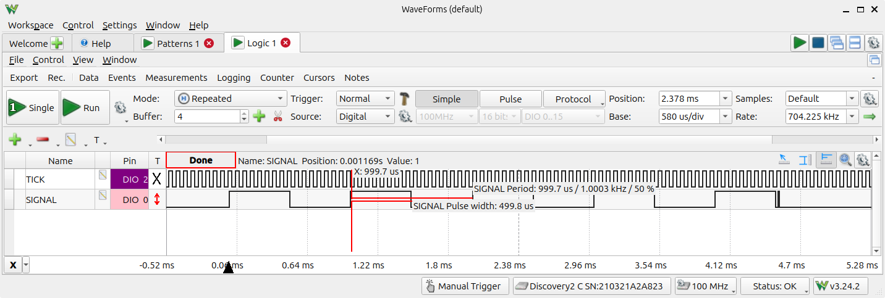
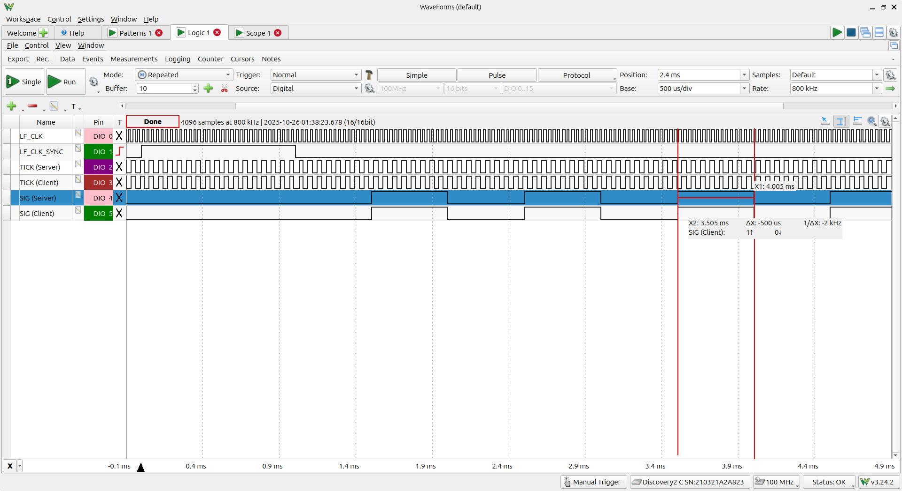
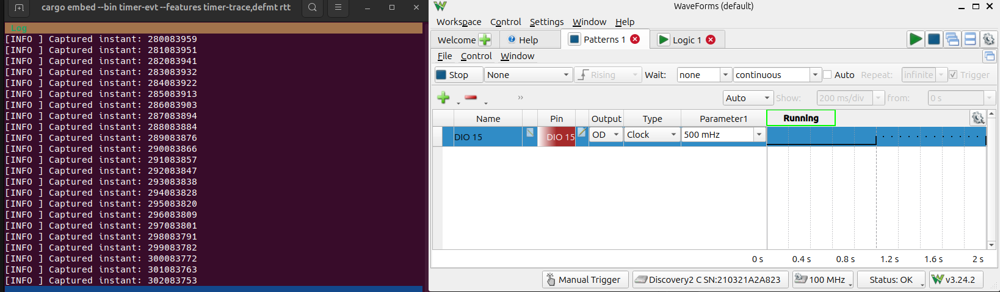

# Timer Driver Examples

The following commands assume that the nRF52840 examples directory is your
current working directory:

```sh
cd examples/nrf52840
```

We have several examples that demonstrate and test the radio and timer drivers.

Some of them can be executed in single-device and multi-device setups. No
special setup is required for single-device tests.

In a multi-device setup a single external lf clock on pin X1 (P0.00) drives
several devices synchronously. At the start of the program, clocks are
synchronized with a shared GPIO signal.

A [special hardware setup](../../../../../docs/testbed/README.md) is required to
synchronize devices. Once you have modified your hardware (and only then),
enable the "device-sync" or "device-sync-client" feature to execute multi-device
examples. "device-sync[-client]" must be enabled whenever the LF clock is driven
by an external signal, otherwise you may damage your hardware.

## High-Precision Timer Driver Test

The high-precision timer can be triggered and traced via GPIO:

- The `timer-sig` sample generates pulses on the trace pin.
- The `timer-evt` sample observes and logs timestamps of externally generated pulses on the trace pin.

See lib.rs for pin assignments.

Both examples need to be built with the `timer-trace` feature.

### Timer Signal Generator

```sh
cargo embed --release --bin timer-sig --features timer-trace[,device-sync] flash
```

Sample measurement from the `timer-sig` example:



The `measure-rtc-skew` example in `dot15d4-driver/examples/nrf` can be used to
quantify skew.

If you enable the "device-sync" feature, then the `timer-sig` example can be
used to verify proper device clock synchronization when run in a properly
configured [hardware testbed](../../../../../docs/testbed/README.md):



Device synchronization is triggered through YAPicoProbe's debug terminal via the
dot15d4-specific "sync" command. See the radio example above for a more detailed
description of device synchronization.

### Timer Event Observer

The timer event observer requires an external signal to be applied to the trace pin.

Then build and run the example as follows:

```sh
cargo embed --release --bin timer-evt --features timer-trace,defmt flash
cargo embed --release --bin timer-evt --features timer-trace,defmt rtt
```

Sample measurement from the `timer-evt` example:



Note: The even observer example only runs in single-device mode.

### Timer Toggle Measurement

The `timer-toggle` example toggles the trace pin every `PERIOD` nanoseconds
through the exact same timer path the radio driver uses, so the resulting
timing can be characterised on a logic analyzer:

```sh
cargo embed --release --bin timer-toggle --features timer-trace,defmt flash
```

[`timer-toggle-analysis.md`](timer-toggle-analysis.md) explains and quantifies
every error term along that path.
